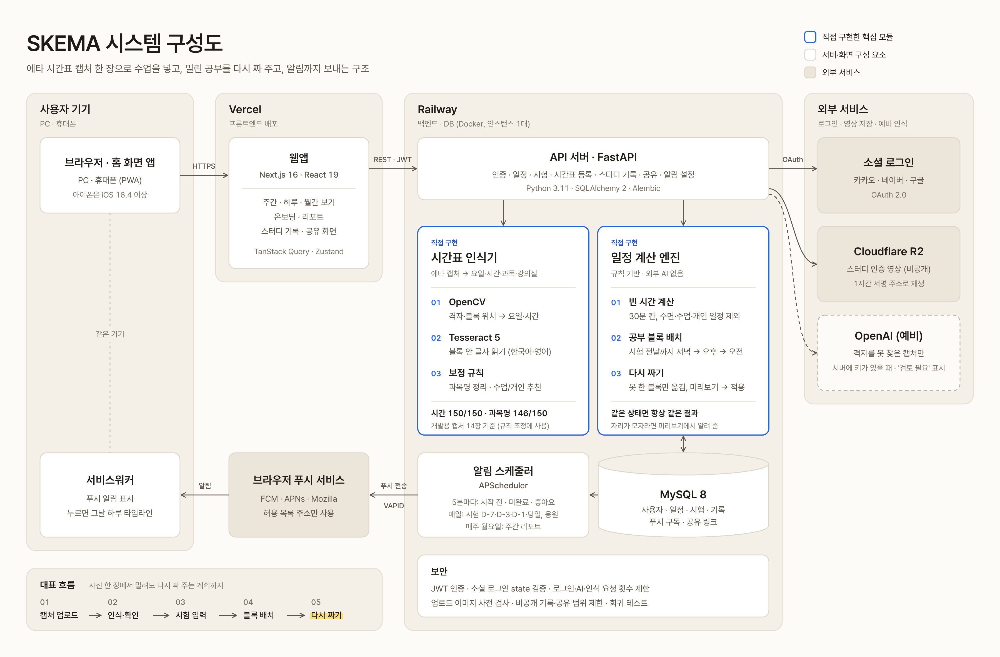

# SKEMA — 밀려도 다시 짜 주는 대학생 시간표

> 에타 시간표 사진 한 장으로 수업을 넣고, 시험 공부를 빈 시간에 배치하고, 못 한 공부는 시험 전날까지 다시 짜 주는 웹앱

단국대학교 2026 졸업작품 · 캡스톤 페스티벌 2026 출품작 · 팀 SKEMA

| | |
| --- | --- |
| 🌐 서비스 | https://skema-dku.vercel.app (PC 브라우저, 휴대폰은 '홈 화면에 추가'로 앱처럼 사용) |
| 🎬 시연 영상 | 준비 중 (11/16 제출 전 유튜브 링크 추가) <!-- TODO: 유튜브 링크 --> |
| 🖼️ 포스터 | 준비 중 → [`docs/poster/`](docs/poster/) <!-- TODO: SKEMA_poster.pdf --> |
| 📘 결과보고서 | 준비 중 → [`docs/report/`](docs/report/) <!-- TODO: SKEMA_report.pdf --> |
| 📑 API 문서 | https://backend-production-e565.up.railway.app/docs (Swagger) |
| 📂 개발 문서 | [`docs/`](docs/README.md) |
| 🗺️ 로드맵 | [노션 공개 로드맵](https://pyrite-spice-b15.notion.site/3e6529d680e1805bb40df494059293eb?v=3e6529d680e1807da366000c6a9bae9e) (9/26 방향 결정 → 11/27 전시, 47개 항목·담당·상태) |

---

## 1. 왜 만들었나

대학생의 하루는 매주 반복되는 수업 위에 과제, 시험 공부, 아르바이트가 겹쳐 있습니다. 수업은 에브리타임에, 약속은 캘린더에, 시험 공부 계획은 머릿속에 흩어져 있어 **오늘 할 일을 한눈에 보기 어렵고**, 계획을 세워도 **하나가 밀리면 다시 짜기 귀찮아 계획 자체를 버리게 됩니다.**

SKEMA는 이 두 가지, **"하루를 한눈에"** 와 **"밀려도 다시 맞춰 주기"** 에 집중합니다.

## 2. 핵심 흐름

| 단계 | 사용자 | SKEMA |
| --- | --- | --- |
| 1 | 에타 시간표 캡처를 올린다 | 수업·개인 일정(알바 등)을 읽어 매주 반복 일정으로 등록 (강의실 포함) |
| 2 | 시험 날짜·과목을 넣는다 (온보딩 또는 대시보드 [+ 시험 추가]) | 시험 전날까지 빈 시간에 30분 단위 공부 블록을 자동 배치 |
| 3 | 앱을 연다 | 첫 화면은 주간 보기, 날짜를 누르면 **하루 타임라인** |
| 4 | 끝낸 블록을 체크한다 | 완료 처리, 시험별 **준비도(%)** 에 반영 |
| 5 | 못 한 블록이 생기면 **다시 짜기**를 누른다 | 남은 빈 시간에 다시 배치 (미리보기 → 적용) |
| 6 | 알림을 받는다 | 시작 N분 전 '곧 시작', 끝났는데 미완료면 '미완료' 푸시. 누르면 그날 타임라인 |

## 3. 주요 기능

**핵심**
- **시간표 인식기 (직접 구현)** — OpenCV로 격자·블록 위치를, Tesseract로 글자를 읽고 자체 보정 규칙으로 과목명·강의실을 정리합니다. 이름에 '알바·스터디·회의' 같은 말이 있고 강의실이 없으면 개인 일정으로 먼저 골라 두고, 확인 화면에서 줄마다 [수업 | 개인]을 고르고 고칠 수 있습니다. 규칙을 맞추는 데 쓴 개발용 캡처 14장에서 시간 150/150, 과목명 146/150이고, 처음 보는 캡처로 잰 정확도는 인식기 문서에 따로 적습니다. → [시간표 인식기 문서](docs/timetable-recognition.md)
- **공부 블록 자동 배치** — 수업·개인 일정·수면 시간을 피해 30분 칸으로 빈 시간을 계산하고, 시험이 가까운 날부터 저녁 → 오후 → 오전 순으로 채웁니다. 며칠 전부터·주 며칠·하루 몇 시간을 고를 수 있고, 블록은 시험에 연결되어 준비도에 반영됩니다.
- **하루 타임라인** — 그날의 수업·공부·일정을 시간순으로 보여주고, 블록 사이 빈 시간과 지금 시각을 표시합니다.
- **다시 짜기 (규칙 기반)** — 시작 시간이 지났는데 못 한 공부·과제 블록만 시험 전날까지 남은 빈 칸으로 옮깁니다. 수업·시험·개인 일정은 움직이지 않고, 같은 상황이면 항상 같은 결과가 나옵니다. 자리가 부족하면 미리보기에서 알려 줍니다.
- **시험 준비도** — 시험에 연결된 공부 블록 중 완료한 비율. D-3 이하 50% 미만은 빨강, D-7 이하 70% 미만은 주황.
- **웹 푸시 알림** — 앱이 꺼져 있어도 받습니다. 종류마다 켜고 끌 수 있습니다.

  | 알림 | 시점 |
  | --- | --- |
  | 일정 시작 전 | 5분마다 확인, 시작 5·10·15·30·60분 전 (선택, 기본 30분) |
  | 미완료 | 일정이 끝났는데 완료 안 했을 때 (누르면 그날 타임라인 → 다시 짜기) |
  | 시험 D-day | 매일 08:00, D-7 · D-3 · D-1 · 당일 |
  | 주간 리포트 · 학습 비교 | 매주 월요일 08:00 (학습 비교는 기본 꺼짐) |
  | 학습 동기 부여 | 매일 09:00 |
  | 그룹 새 기록 · 좋아요 | 그룹원이 기록을 올릴 때 · 내 기록에 좋아요가 달릴 때 (좋아요는 5분 단위로 묶어서) |

**그 밖에**
- 월간 보기, 주간 수행률 리포트(요일별·유형별), 시간표 공유 링크(읽기 전용, 수업만)
- 앱 안 알림 목록, 시간표 개인화(기상·취침 시간, 대학생 시간표 모드)
- 스터디 그룹(초대코드·이름 검색으로 참여) 인증 기록(3초 영상·글, Cloudflare R2 비공개 저장), 이모지 반응·스트릭
- 이메일 로그인 + 카카오·네이버·구글 소셜 로그인
- [개인정보처리방침](https://skema-dku.vercel.app/privacy)

## 4. 시스템 구성



- **직접 구현한 핵심 모듈**(파란 테두리): 시간표 인식기(OpenCV + Tesseract + 보정 규칙), 일정 계산 엔진(빈 시간 계산 → 공부 블록 배치 → 다시 짜기)
- 알림은 서버 안의 스케줄러(APScheduler)가 확인해 브라우저 푸시 서비스로 보내고, 휴대폰·PC의 서비스워커가 표시합니다.
- 시간표 인식·공부 블록 배치·다시 짜기는 외부 AI API 없이 동작합니다. 위치 파서가 격자를 아예 찾지 못한 이미지에 한해, 서버에 OpenAI 키가 있으면 예비 경로로 읽습니다 (결과는 '검토 필요'로 표시). <!-- TODO(팀 확인): 예비 경로를 남길지, 막고 이 문장을 지울지 -->
- 원본 그림(포스터용 벡터): [`SVG`](docs/images/system-architecture.svg) · [`PDF`](docs/images/system-architecture.pdf)

자세한 구성과 데이터 흐름은 [`docs/architecture.md`](docs/architecture.md), DB 구조는 [`docs/erd.md`](docs/erd.md)에 있습니다.

### 보안

| 항목 | 방법 |
| --- | --- |
| 인증 | 비밀번호 암호화 저장, JWT(24시간). 소셜 로그인은 state 검증, 같은 이메일의 기존 계정에 자동 연결하지 않음 |
| 남용 방지 | 로그인 실패(15분 10회)·AI 요청·시간표 인식 요청 횟수 제한, 업로드 이미지는 풀기 전에 형식·크기 검사 |
| 개인정보 | 비공개 기록은 본인만, 공유 링크는 수업만, 인증 영상은 비공개 저장소 + 1시간 서명 주소, 시간표 이미지는 인식 후 저장하지 않음 |
| 운영 | 비밀값은 환경변수에만, 운영에서 기본 서명 키면 서버가 시작하지 않음, 마이그레이션 실패 시 배포 중단 |

11/7 코드 리뷰에서 찾은 문제 9건을 이슈 [#39](https://github.com/skema2026/skema/issues/39)~[#47](https://github.com/skema2026/skema/issues/47)로 고치고, 같은 문제가 다시 생기지 않도록 회귀 테스트(`backend/tests/security`)를 붙였습니다.

## 5. 기술 스택

| 영역 | 기술 |
| --- | --- |
| 프론트엔드 | TypeScript, Next.js 16 (App Router), React 19, Tailwind CSS 4, TanStack Query 5, Zustand 5, Axios, Service Worker(Web Push) |
| 백엔드 | Python 3.11, FastAPI, SQLAlchemy 2, Alembic, APScheduler, pywebpush, JWT |
| 시간표 인식 | OpenCV, Tesseract 5 (한국어·영어 `tessdata_best` 4.1.0), pytesseract |
| 데이터 | MySQL 8, Cloudflare R2 (S3 호환, 1시간 서명 주소) |
| 배포 | Vercel (프론트), Railway (백엔드·DB, Docker), GitHub (PR·리뷰 필수) |

## 6. 실행 방법

### 바로 써 보기
https://skema-dku.vercel.app 에서 회원가입 후 온보딩(시간표 캡처 → 확인 → 시험 → 개인 일정 → 수면 시간)을 따라가면 됩니다. 휴대폰에서 푸시 알림을 받으려면 브라우저 메뉴의 **'홈 화면에 추가'** 로 연 앱에서 알림을 허용하세요 (아이폰은 iOS 16.4 이상).

### 로컬에서 실행 (Docker Compose)
필요한 것: Docker Desktop

```bash
git clone https://github.com/skema2026/skema.git
cd skema
cp .env.example .env          # 기본값으로도 로컬 실행 가능. 소셜 로그인·푸시 키는 선택
docker compose up --build     # MySQL + 백엔드(:8000) + 프론트(:3000)
```

- 웹: http://localhost:3000 · API 문서: http://localhost:8000/docs
- DB 마이그레이션은 백엔드 컨테이너가 켜질 때 자동으로 실행됩니다. 실패하면 서버가 뜨지 않으니 로그를 확인하세요.
- 로컬에서는 인증 영상이 `backend/uploads`에 저장됩니다 (`STORAGE=local`). 운영은 `STORAGE=r2`.
- 웹 푸시를 쓰려면 `python3 scripts/generate-vapid-keys.py`로 키를 만들어 `.env`의 `VAPID_*`에 넣습니다.

### 테스트

```bash
# 백엔드 (Tesseract가 설치된 환경)
cd backend && pip install -r requirements.txt && python -m pytest tests -q

# 프론트엔드
cd frontend-next && npm ci && npx tsc --noEmit && npx eslint src && npm run build
```

백엔드 자동 테스트 **199개** (11/9 기준). 이 밖에 2개는 준비물이 있을 때만 실행합니다: 실제 캡처 정확도 측정(`ETA_FIXTURE_DIR`에 캡처와 정답 파일), R2 저장소 테스트(`moto` 패키지)

| 영역 | 개수 | 확인하는 것 |
| --- | --- | --- |
| `tests/eta` | 48 | 시간표 글자 보정, 시간 계산, 인식 실패 시 안전망 |
| `tests/schedule` | 45 | 빈 시간 계산, 공부 블록 배치, 다시 짜기, 시간표 저장 |
| `tests/security` | 48 | 비공개 기록, 소셜 로그인, 요청 제한, 이미지 검사, 푸시 주소, 공유 범위, 검색 |
| `tests/notification` | 30 | 알림 시점, 알림을 누르면 이동할 화면 |
| `tests/studylog` | 28 | 스터디 그룹·기록 |

운영 배포 방법은 [`docs/deploy.md`](docs/deploy.md)에 있습니다.

## 7. 프로젝트 구조

```
skema/
├── backend/                  FastAPI 서버
│   ├── app/
│   │   ├── auth/             회원가입·로그인·소셜 로그인·프로필(기상·취침 시간)
│   │   ├── schedule/         일정·시험 CRUD, 빈 시간 계산(free_slots), 공부 블록 배치(study_blocks), 다시 짜기(reschedule)
│   │   ├── eta/              시간표 인식 (positional_parser: 격자·블록 위치 / block_ocr: 글자 읽기·보정 / image_guard: 업로드 검사)
│   │   ├── notification/     웹 푸시, 앱 안 알림, 예약 작업(scheduler)
│   │   ├── studylog/         스터디 그룹·인증 기록·반응·스트릭
│   │   ├── share/            시간표 공유 링크
│   │   ├── admin/            관리자(로그인 기록·사용자)
│   │   ├── ai_chat/          AI 채팅·준비도 요약 API (화면에서는 #37에서 뺌)
│   │   └── core/ · db/       설정, 보안(JWT), 요청 횟수 제한, 파일 저장소(로컬·R2), DB 세션
│   ├── alembic/              DB 마이그레이션 (001~018)
│   └── tests/                pytest (eta · schedule · security · notification · studylog)
├── frontend-next/            Next.js 웹앱
│   ├── src/app/              화면 (dashboard: 주간·하루·월간 / onboarding / report / log / notifications / profile / share / privacy / admin)
│   ├── src/hooks · lib · store
│   └── public/sw.js          서비스워커 (푸시 알림 표시·클릭 이동)
├── docs/                     개발 문서·제출물 (images/: 시스템 구성도)
├── scripts/                  VAPID 키 생성, 다시 짜기 점검, 서버 한 대 배포 스크립트(deploy-prod.sh)
├── deploy/                   서버 한 대로 직접 띄울 때 쓰는 Caddy 설정 (참고용)
└── docker-compose*.yml       로컬·단일 서버 실행
```

## 8. 팀

| 이름 | 역할 | 주요 작업 |
| --- | --- | --- |
| 최호준 | PM · 백엔드 | 방향·스펙, 인프라·배포, 시간표 인식기, 알림·준비도, 소셜 로그인, 통합 테스트 |
| 최원석 | 백엔드 | 다시 짜기, 빈 시간 계산·공부 블록 배치, 영상 저장소(R2), 보안 점검·수정, 시스템 구성도 |
| 이서현 | 프론트엔드 · 디자인 | 대시보드 구조, 하루 타임라인 화면, 앱 아이콘, 포스터 |

단국대학교 SW융합대학 · 2026 졸업작품 · GitHub 조직 [skema2026](https://github.com/skema2026)
1학기(캡스톤디자인) 개발 이력은 커밋 기록에 그대로 남아 있습니다.

## 9. 협업 방식

- 작업 하나 = GitHub 이슈 하나, 이슈마다 브랜치 (`feat/…`, `fix/…`, `docs/…`)
- `main` 직접 push 금지 · PR 필수 · 승인 1명 · Squash 머지 → `main`은 항상 배포 가능한 상태
- 일정·회의록·결정 기록은 팀 노션에서 관리 (결정 로그: 날짜 · 결정 · 이유). 단계별 일정과 담당은 [공개 로드맵](https://pyrite-spice-b15.notion.site/3e6529d680e1805bb40df494059293eb?v=3e6529d680e1807da366000c6a9bae9e)에서 볼 수 있습니다
