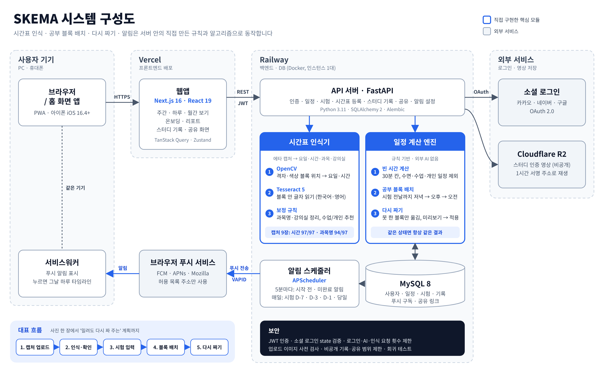
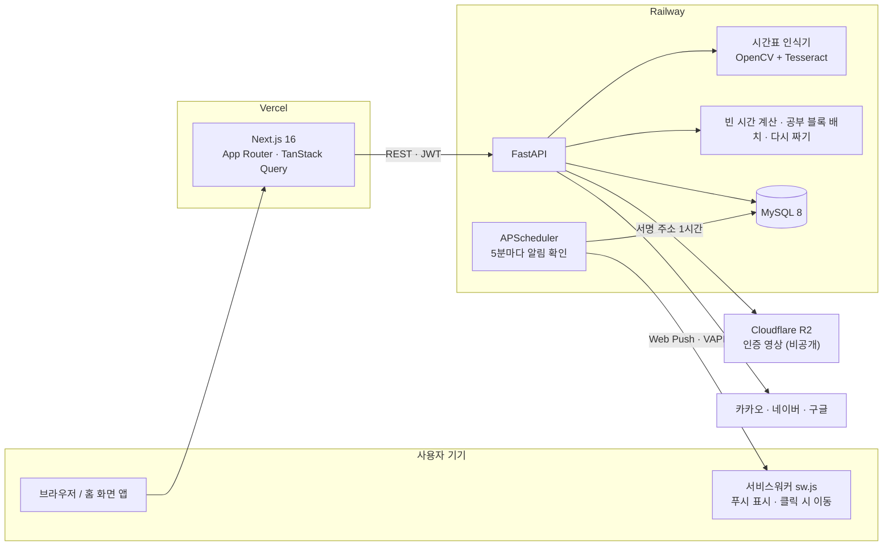
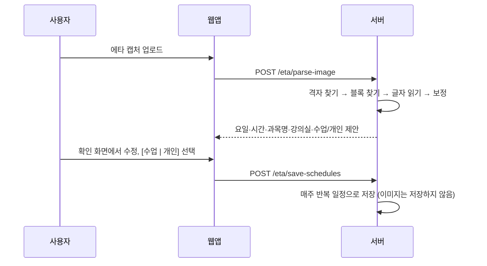
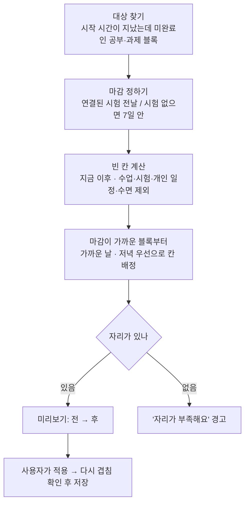

# 시스템 구성과 데이터 흐름

SKEMA는 Next.js 웹앱(Vercel)과 FastAPI 서버(Railway), MySQL로 이루어져 있습니다. 시간표 인식·공부 블록 배치·다시 짜기·알림은 모두 서버 안의 규칙과 알고리즘으로 동작하며 외부 AI API를 쓰지 않습니다.

## 1. 전체 구성

포스터용 원본: [SVG](images/system-architecture.svg) · [PDF](images/system-architecture.pdf). 아래는 같은 구성을 글로 고칠 수 있게 Mermaid로 적은 것입니다.

| 구성 요소 | 역할 | 위치 |
| --- | --- | --- |
| 웹앱 | 주간·하루·월간 보기, 온보딩, 리포트, 스터디 기록 | `frontend-next/src/app` |
| 서비스워커 | 푸시 알림 표시, 누르면 알림이 가리키는 화면(예: 그날 하루 타임라인)으로 이동 | `frontend-next/public/sw.js` |
| API 서버 | 인증, 일정·시험 CRUD, 시간표 인식, 다시 짜기, 알림 설정 | `backend/app/*/router.py` |
| 시간표 인식기 | 캡처 이미지 → 요일·시간·과목명·강의실·수업/개인 | `backend/app/eta/` |
| 일정 계산 | 빈 30분 칸 계산, 공부 블록 배치, 다시 짜기 | `backend/app/schedule/free_slots.py` · `study_blocks.py` · `reschedule.py` |
| 예약 작업 | 블록 알림(5분), 시험 D-day(매일 08:00), 주간 리포트(월 08:00) 등 | `backend/app/notification/scheduler.py` |

## 2. 주요 흐름

### 2.1 시간표 등록

자세한 알고리즘은 [`timetable-recognition.md`](timetable-recognition.md).

### 2.2 시험 → 공부 블록 자동 배치

1. 하루를 30분 칸(:00, :30 시작)으로 나누고 수업·개인 일정·기존 블록·시험이 차지한 칸과 수면 시간(온보딩 설정)을 뺍니다. (`free_slots.py`, 공부 블록 배치와 다시 짜기가 함께 쓰는 공용 계산)
2. 시험 날짜가 가까운 시험부터, 시험 전날까지의 날 중 7일마다 빈 칸이 많은 날을 고릅니다 (기본: 시험 14일 전부터, 주 3일).
3. 고른 날마다 하루 목표만큼 칸을 **저녁(19~24시) → 오후(13~19시) → 오전 → 새벽** 순으로 채우고, 붙어 있는 칸은 한 블록으로 합칩니다.
4. 블록 제목은 `📖 과목 준비`, 시험과 `linked_exam_id`로 연결해 준비도를 계산합니다.

### 2.3 다시 짜기

- API: `POST /reschedule/preview` → `POST /reschedule/apply`
- 계산(`plan_moves`)은 DB 없이 도는 순수 함수라 같은 상태면 항상 같은 결과가 나오고, 자동 테스트로 확인합니다.
- 수업·시험·개인 일정은 절대 옮기지 않습니다.

### 2.4 알림

- 5분마다 오늘 일정을 확인해, 시작 N분 전(5·10·15·30·60분 중 사용자 선택) '곧 시작', 끝났는데 미완료면 '미완료' 알림을 보냅니다. 같은 일정은 하루 한 번만 보냅니다.
- 수업은 매주 반복이라 미완료 알림에서 뺍니다.
- 알림을 누르면 그날 하루 타임라인(`/dashboard?view=day&date=YYYY-MM-DD`)이 열립니다.
- 모든 날짜 계산은 한국 시간 기준입니다 (서버는 UTC).
- 스케줄러가 서버 안에서 돌기 때문에 운영 서버는 잠들지 않게, 1대로 둡니다 ([`deploy.md`](deploy.md)).

## 3. 인증과 보안

- 이메일·비밀번호(암호화 저장) 또는 카카오·네이버·구글 OAuth → 서버가 JWT 발급, 웹앱이 요청마다 `Authorization: Bearer` 로 보냄
- 소셜 로그인: state 쿠키가 없거나 다르면 거절. 같은 이메일의 기존 계정에 자동 연결하지 않음(`/login?error=oauth_email_exists`). 토큰은 `/login#token=…`(fragment)으로 넘겨 서버 로그에 남지 않게 함
- 관리자 주소(`ADMIN_EMAILS`)로는 가입·이메일 변경 불가
- 요청 횟수 제한(`app/core/rate_limit.py`, 서버 메모리): 같은 아이디 로그인 실패 15분 10회, AI 요청 10분 30회, 시간표 인식 10분 10회. 서버가 1대라서 메모리로 셈 (늘리면 Redis 등으로 옮겨야 함)
- 시간표 이미지는 파일 내용으로 형식을 판단하고, 풀기 전에 가로·세로(한 변 12000px, 4천만 픽셀)를 검사
- 웹 푸시 구독 주소는 브라우저 푸시 서비스(FCM·Mozilla·Apple·Windows)만 허용
- 그룹 밖 기록은 공개로 설정된 것만 다른 사람 프로필에 보임. 공유 링크(`/share/{token}`)는 수업만, 화면에 필요한 칸만 보냄
- 인증 영상은 비공개 R2 버킷에 두고 1시간짜리 서명 주소로만 재생
- 시간표 이미지는 인식이 끝나면 저장하지 않음
- 비밀값은 Railway·Vercel 환경변수에만 두고 저장소에는 `.env.example`(빈 값)만 둠

## 4. API

전체 목록은 실행 중인 서버의 Swagger 문서(`/docs`)에서 볼 수 있습니다. 운영: https://backend-production-e565.up.railway.app/docs

| 기능 | 주요 API |
| --- | --- |
| 인증 | `POST /auth/signup` · `POST /auth/login` · `GET /auth/{provider}/authorize` · `GET /auth/{provider}/callback` |
| 일정·시험 | `/schedules` · `/exam-schedules` (CRUD) |
| 시간표 인식 | `POST /eta/parse-image` → `POST /eta/save-schedules` |
| 공부 블록 배치 | `POST /study-blocks/generate` (시작 시점·주당 일수·하루 분량 설정) |
| 다시 짜기 | `POST /reschedule/preview` → `POST /reschedule/apply` |
| 알림 | `GET/PUT /notifications/prefs` · `POST/DELETE /push/subscriptions` |
| 공유 | `/share-tokens` · `GET /share/{token}` |
| 스터디 기록 | `/study-logs` · `/groups` |
