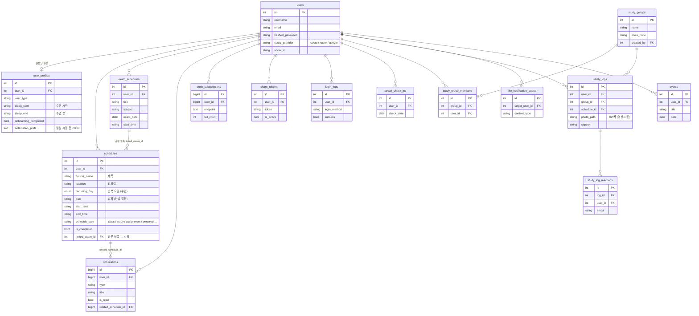

# DB 구조 (ERD)

MySQL 8 · SQLAlchemy 모델 기준 (`backend/app/*/models.py`). 마이그레이션은 `backend/alembic/versions` (001~018).
아래 그림은 주요 칸만 보여줍니다. 전체 칸은 각 모델 파일에 있습니다.

## 테이블 설명

| 테이블 | 내용 |
| --- | --- |
| `users`, `user_profiles` | 계정, 온보딩 값(수면 시간·알림 설정 등) |
| `schedules` | 모든 일정. 수업은 `recurring_day`로 매주 반복, 공부·과제·개인 일정은 `date`로 단발. 공부 블록은 `linked_exam_id`로 시험과 연결 → 준비도 계산 |
| `exam_schedules` | 시험 날짜·과목 |
| `notifications`, `push_subscriptions` | 알림 기록, 브라우저 푸시 구독 (실패가 쌓이면 정리) |
| `share_tokens` | 읽기 전용 시간표 공유 링크 |
| `study_groups`, `study_group_members`, `study_logs`, `study_log_reactions`, `streak_check_ins`, `like_notification_queue` | 스터디 그룹 인증 기록·좋아요·스트릭 |
| `login_logs` | 로그인 기록 (관리자 화면) |
| `events` | 1학기 단발 일정 테이블 (지금은 `schedules`의 `date` 사용) |
| `ai_chat_logs` | 1학기 AI 채팅 기록 (2학기 화면에서 AI 기능 제외, 테이블만 남음) |
| `posts`, `post_likes` | 1학기 커뮤니티 (11/2 코드에서 제거, 되돌릴 수 없는 DB 삭제는 하지 않아 테이블만 남음) |
