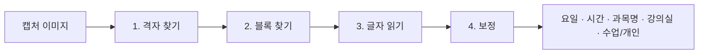

# 시간표 인식기

에브리타임 시간표 캡처 한 장에서 수업의 **요일·시작·끝 시간·과목명·강의실**을 읽고, 알바·운동 같은 **개인 일정**을 구분합니다. 외부 AI API 없이 OpenCV(이미지 처리)와 Tesseract(글자 인식)에 자체 규칙을 더해 만들었습니다.

- 코드: `backend/app/eta/positional_parser.py` (격자·블록 위치), `backend/app/eta/block_ocr.py` (글자 읽기·보정), `backend/app/eta/router.py` (API)
- 테스트: `backend/tests/eta/`
- API: `POST /eta/parse-image` (이미지 → 결과) → 사용자가 확인 화면에서 고친 뒤 `POST /eta/save-schedules`

## 왜 직접 만들었나

1학기에는 칸 위치는 간단한 위치 파서로, 과목명은 OpenAI(GPT-4.1)로 읽었습니다. 키가 없으면 과목명이 비었고, 7시 시작·50분 수업 같은 형식에서 시간이 틀렸습니다. 2학기에는 비용과 외부 의존을 없애고 우리 기술로 만든 기능을 갖기 위해 전부 직접 구현했습니다.

## 처리 단계



### 1. 격자 찾기
- 왼쪽 시간 칸에서 **같은 간격으로 가장 길게 이어지는 가로선 묶음**을 골라 직선으로 맞춥니다 → 1시간이 몇 픽셀인지, 기준선이 어디인지 계산
- 시간 숫자(9, 10, 11 …)를 Tesseract로 읽어 **맨 위 시각**을 정합니다 (7시·8시에 시작하는 시간표 대응). 숫자를 못 읽으면 9시 시작으로 봅니다
- 요일 구분 세로선이 시작되는 위치로 표의 맨 위(요일 머리 아래)를 찾습니다

### 2. 블록 찾기
- 요일 칸마다 **픽셀 줄 단위로 위에서 아래로 훑어** 색이 있는 블록을 찾습니다. 칸 양옆 가장자리와 안쪽의 색 비율로 블록인지 판단해 글자 때문에 끊기지 않게 합니다
- 위아래로 붙은 두 수업은 **바탕색이 바뀌는 곳**에서 나눕니다
- 블록 위·아래 위치를 시간으로 바꿔 **5분 단위로 맞춥니다** (50분·75분 수업 대응). 범위는 05:00~24:00
- 라이트·다크 모드, iOS·안드로이드 캡처 모두 같은 방식으로 처리

### 3. 글자 읽기
- 블록마다 잘라서 테두리선 제거 → 흰 글씨면 반전 → 줄 나누기 → **글자 높이를 48px로 맞춤** → Tesseract(한국어+영어, `tessdata_best`)
- 마지막 줄이 '건물+호수' 모양(`소프트516`, `2공105`)이면 강의실, 나머지 줄은 과목명으로 나눕니다

### 4. 보정
| 규칙 | 예 |
| --- | --- |
| 과목명 단어 사전 + 자모 거리로 비슷한 글자 오인식 보정 (이미 사전에 있는 단어는 건드리지 않음) | 받침·모음 하나가 틀린 글자 |
| 영어 약어는 영어 모델로 다시 읽고, 알려진 약어 목록에 있을 때만 바꿈 | `DBMS`, `FPGA`, `SW` |
| 강의실 번호 정리 ('공'을 숫자로 잘못 읽은 경우) | `25105` → `2공105` |
| 같은 과목의 여러 블록(주 2회 등) 이름 통일 | 화·목 수업 이름을 같게 |
| **개인 일정 제안**: 강의실이 없고 '알바·운동·헬스·학원·스터디' 같은 단어가 있으면 '개인' | 확인 화면에서 [수업 \| 개인]으로 바꿀 수 있음 |

## 정확도

| 데이터 | 캡처 | 블록 | 시간 | 과목명 | 강의실 |
| --- | --- | --- | --- | --- | --- |
| 개발용 (규칙 조정에 사용) | 14장 | 150 | 150/150 | 146/150 | 125/126 |
| 처음 보는 캡처 (발표 수치) | 5장 | 측정 중 | | | |

**과적합을 찾아 고친 과정**: 처음 캡처 5장에 맞춘 인식기를 새 캡처 9장에 돌리자 시간 정답률이 33%로 떨어졌습니다. 특정 캡처에 맞춘 숫자를 버리고 위의 일반 규칙(시간선 묶음, 시간 숫자 읽기, 표 맨 위 찾기, 줄 단위 훑기)으로 바꾼 뒤 14장 전체에서 다시 맞췄습니다. 이 14장은 조정에 쓴 데이터라 발표 수치는 처음 보는 캡처로 따로 잽니다.

## 로컬에서 돌려 보기

```bash
# Tesseract와 한국어 데이터가 필요 (Docker 이미지에는 들어 있음)
cd backend
python -m pytest tests/eta -q
# 실제 캡처로 확인: 캡처와 정답 파일이 있는 폴더를 지정
ETA_FIXTURE_DIR=/path/to/captures python -m pytest tests/eta -q
```

설정: `ETA_TEXT_ENGINE=ocr`(기본, 우리 인식기) · `ETA_OPENAI_FALLBACK=false`(기본, 외부 AI 안 씀)
